LABORATORIO INTEGRADOR \| BLOQUE 2

SC-LAB-006

# GUÍA DEL ESTUDIANTE

Instrucciones, código inicial, actividades y registro de evidencias

Temas: 2.1 Patrones · 2.2 Resiliencia · 2.3 Validación · 2.4 Sesiones y acceso · 2.5 Criptografía · 2.6 Dependencias y errores · 2.7 CI/CD

Proyecto: SecureCampus \| Modalidad: equipos de cuatro \| Duración: 2 sesiones de 120 minutos + entrega posterior de documentación

# 1. Propósito y reglas

Tu equipo recibirá una API Flask de calificaciones y una base SQLite que se crea automáticamente con datos ficticios. NO programarán toda la aplicación. Su misión es completar controles de seguridad, comprobarlos con pruebas y explicar las decisiones de diseño.

Trabajen solo en entorno local y en repositorio académico privado. Las credenciales del ejercicio son ficticias; no suban información real ni secretos. No alteren las pruebas para ocultar errores. El paquete inicial contiene fallas deliberadas en validación y autorización.

# 2. Entrega y evaluación

| Entregable   | Evidencia requerida                                     |
|--------------|---------------------------------------------------------|
| Repositorio  | Código corregido, historial de commits y PR             |
| Informe      | Matriz de riesgos y permisos; arquitectura y decisiones |
| Pruebas      | Salida de pytest y auditoría de dependencias            |
| CI           | Captura de ejecución en GitHub Actions                  |
| Demostración | 5 minutos por equipo + preguntas individuales           |

# 3. Preparación: ejecutar la base de datos de prueba

Descarga y descomprime SecureCampus_SC-LAB-006_ESTUDIANTE.zip. En VS Code abre la carpeta extraída. Desde PowerShell, ejecuta:

python -m venv .venv\
.\\.venv\Scripts\Activate.ps1\
python -m pip install -r requirements.txt -r requirements-dev.txt\
python -m pytest –q

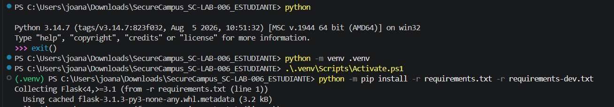

New-Item -ItemType Directory -Force evidencias

python -m pytest -q \> evidencias\diagnostico_inicial.txt 2\>&1

python -m pytest tests/test_security.py -k test_grade_invalid -q

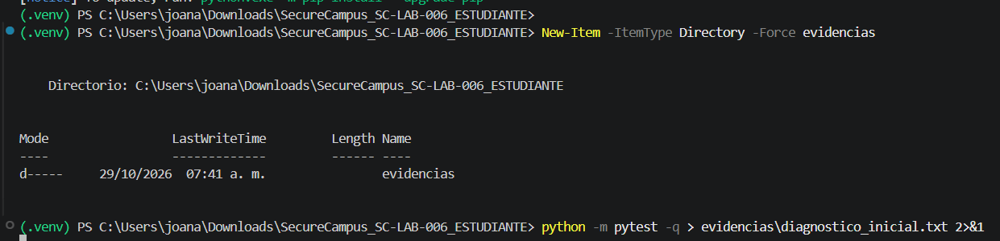

La base de datos de cada prueba se genera automáticamente en una carpeta temporal. Para iniciar el servidor local: python -m src.app. Se creará securecampus_demo.db con usuarios, grupos y calificaciones ficticios. La primera ejecución de pytest DEBE mostrar errores: son el punto de partida.

| Usuario ficticio | Rol           | Grupo / recurso                             |
|------------------|---------------|---------------------------------------------|
| profe_ana        | Profesor      | ISC401 (10)                                 |
| profe_luis       | Profesor      | ISC402 (20)                                 |
| alumna_eli       | Estudiante    | ISC401 (alumno 3)                           |
| alumno_paz       | Estudiante    | ISC402 (alumno 4)                           |
| admin_demo       | Administrador | Sin facultad de modificar notas por defecto |

Contraseña de demostración para todos: Laboratorio2026! (únicamente entorno local).

# 4. Distribución de tareas

| Rol                 | Responsabilidad                                     |
|---------------------|-----------------------------------------------------|
| Arquitectura        | Matriz de riesgos y diseño ante fallas              |
| Backend             | Validación, SQL y tratamiento de errores            |
| Identidad y acceso  | Autenticación, sesión, permisos y pruebas negativas |
| Calidad / DevSecOps | Pruebas, dependencias y CI                          |

# 5. Actividad A: diseño seguro y resiliencia (2.1–2.2)

Dibuja el flujo de actualización de calificaciones: autenticación → CSRF → autorización → validación → transacción de calificación y evento de notificación. Identifica dónde debe denegarse el acceso cuando falle una comprobación. El sistema guarda en la misma transacción una fila en notification_outbox; el envío real no se implementa.

| Riesgo o falla | Control propuesto | Prueba / evidencia |
|----|----|----|
| Profesor de otro grupo | Control de acceso basado en recursos (RBAC/ABAC) en permissions.py que consulta teacher_groups en la BD. | pytest -k test_unauthorized_teacher (Devuelve HTTP status 403 Forbidden). |
| Servicio de notificaciones no disponible | Patrón **Transactional Outbox**: la notificación se guarda en la tabla notification_outbox dentro de la misma transacción de la nota. | La transacción se completa exitosamente (200 OK) aunque el worker de correo esté caído. |
| Datos de calificación inválidos | Validación estricta con tipo y rango en validators.py (rechaza string, booleanos, NaN e inf). | pytest tests/test_security.py -k test_grade_invalid (Devuelve HTTP status 400 Bad Request). |
| Sesión revocada | Verificación del hash del token de sesión en la BD mediante auth.py en cada petición. | Intento de petición con sesión expirada o tras /logout (Devuelve HTTP status 401 Unauthorized). |

Preguntas: ¿por qué la notificación no debe bloquear la calificación?

Para mantener la **resiliencia y disponibilidad**. Si la pasarela o servicio de correos/notificaciones falla o está fuera de línea, la transacción principal (guardar la nota) debe completarse de forma segura. Se usa el patrón *Outbox* para procesar envíos asíncronamente después.

¿Por qué no puede aplicarse la misma degradación al control de autorización?

Porque la **autorización es un control crítico de seguridad (Fail-Closed)**. Si falla la comprobación de quién eres o qué permisos tienes, la operación DEBE denegarse por defecto para prevenir accesos no autorizados o fuga de datos.

# 6. Actividad B: validación (2.3)

Completa src/validators.py. Acepta calificaciones de 0 a 100 con máximo dos decimales; rechaza booleanos, NaN, infinito, cadenas vacías, texto no numérico y valores fuera de rango. No redondees silenciosamente. Ejecuta pytest y registra qué casos cambiaron de fallo a éxito.

\# Archivo que debes modificar\
src/validators.py\
\
\# Comando de verificación\
python -m pytest tests/test_security.py -q

| Entrada | Esperado | Resultado real |
|----|----|----|
| 85 | Aceptar | Aceptado (200 OK / Válido) |
| 99.50 | Aceptar | Aceptado (200 OK / Válido) |
| 150 | Rechazar (400) | **Rechazado (400 Bad Request)** — Fuera de rango \[0, 100\] |
| NaN | Rechazar (400) | **Rechazado (400 Bad Request)** — Valor no numérico especial (NaN) |
| 99.999 | Rechazar (400) | **Rechazado (400 Bad Request)** — Excede 2 decimales |

# 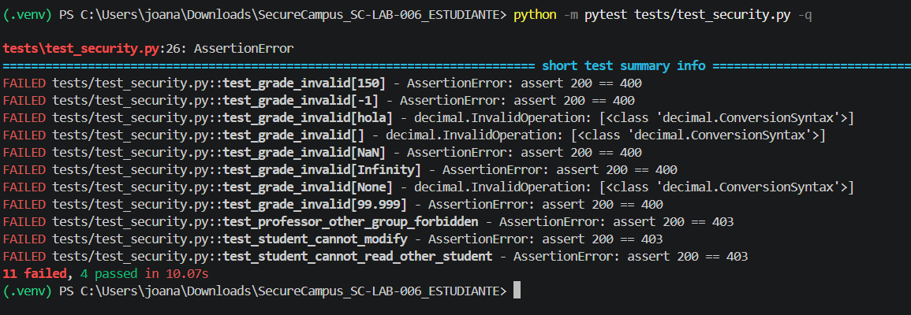

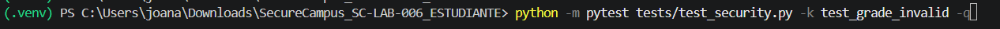

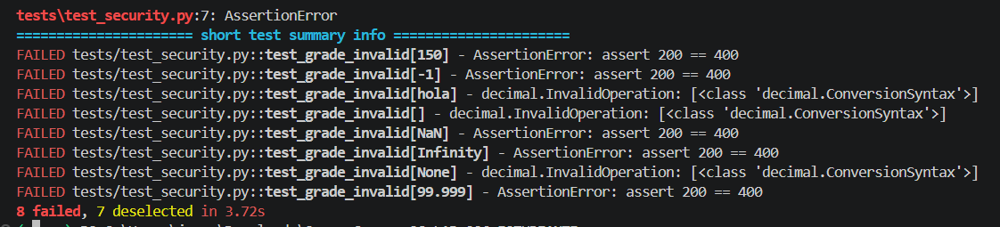

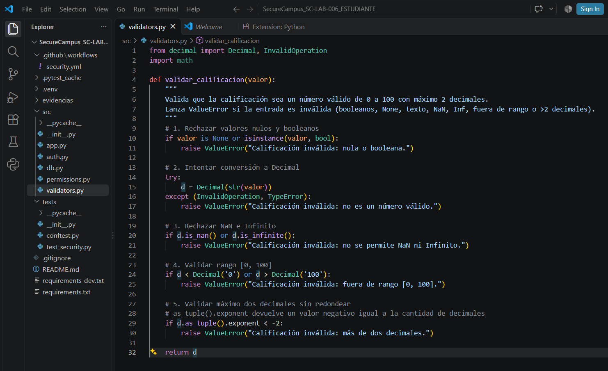

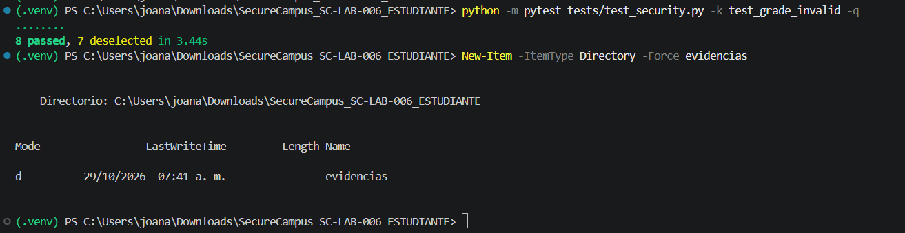

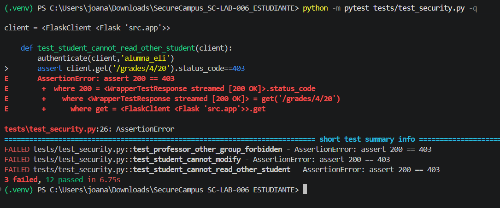

# 7. Actividad C: acceso por recurso (2.4)

Completa src/permissions.py. Un profesor solo modifica calificaciones de estudiantes inscritos en sus grupos; un estudiante solo consulta la suya. El administrador no modifica notas por defecto. Consulta siempre las asignaciones en la base del servidor. Prueba casos permitidos y denegados.

| Caso | HTTP esperado | Resultado real |
|----|----|----|
| Profesor propio / PUT | 200 | Acción permitida: el profesor imparte el grupo y el estudiante está inscrito. |
| Profesor ajeno / PUT | 403 | Denegado: el profesor no está asignado al grupo objetivo |
| Estudiante ajeno / GET | 403 | Denegado: un estudiante no puede consultar calificaciones de otros usuarios |
| Estudiante propio / GET | 200 | Acción permitida: el estudiante consulta exclusivamente sus propios datos |
| Sin sesión / GET | 401 | Rechazado: la solicitud no incluye una sesión o autenticación válida |
| Sin CSRF / PUT | 403 | Rechazado: la solicitud de modificación no incluye la cabecera |

# 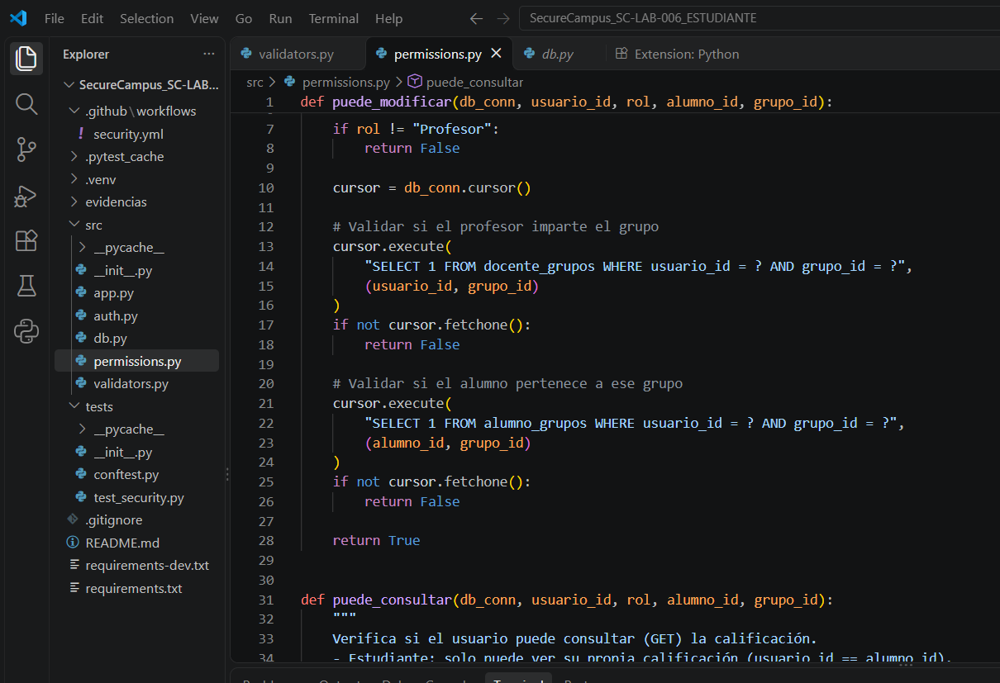

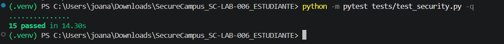

# 8. Actividad D: criptografía y sesiones (2.4–2.5)

Inspecciona src/auth.py y src/db.py. Identifica el uso de generate_password_hash, check_password_hash, secrets.token_urlsafe y el hash del token de sesión guardado en SQLite. Explica qué se almacena y qué no. Verifica que /logout invalida la sesión y que el servidor exige token CSRF para cambios.

1\. ¿Cuál es la diferencia entre hash de contraseña y cifrado?

El hash transforma una contraseña en un valor que no se puede revertir directamente para recuperar la contraseña original. En cambio, el cifrado protege la información mediante una clave que permite descifrarla posteriormente.

2\. ¿Qué atributo impide que JavaScript lea la cookie?

El atributo HttpOnly, ya que impide que JavaScript acceda directamente a la cookie mediante document.cookie. En este proyecto se utiliza para proteger la cookie de sesión.

3\. ¿Qué limitación presenta este ejemplo frente a un sistema de producción?

Una de las principales limitaciones es que utiliza SQLite y usuarios de prueba con una contraseña conocida. Además, no implementa todas las medidas de seguridad necesarias para un entorno real, como protección contra intentos repetidos de inicio de sesión, monitoreo de accesos y HTTPS obligatorio en todos los despliegues.

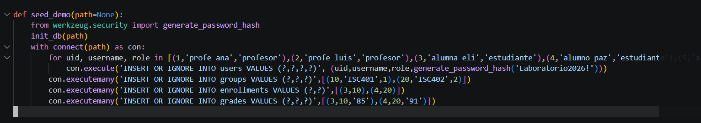

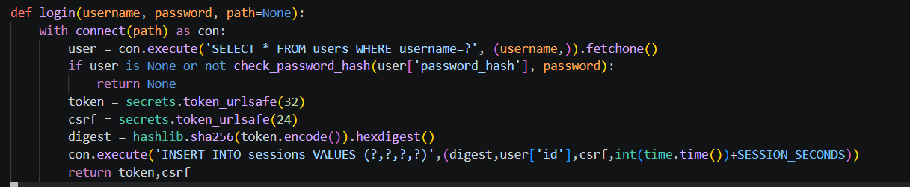

# 9. Actividad E: dependencias, errores y archivos (2.6)

Localiza consultas SQL parametrizadas en src/app.py. Comprueba que los mensajes HTTP no exponen trazas internas. Ejecuta python -m pip_audit -r requirements.txt y documenta los hallazgos. Propón, sin implementarlo, una descarga de constancia por ID con autorización del propietario y ruta obtenida de la base de datos.

| Dependencia | Versión resuelta | Hallazgo / acción |
|----|----|----|
| Flask | Pendiente de comprobar | Registrar resultado de pip-audit. |
| Werkzeug | Pendiente de comprobar | Registrar resultado de pip-audit. |
| Otra dependencia | Pendiente de identificar | Registrar versión y resultado. |

# 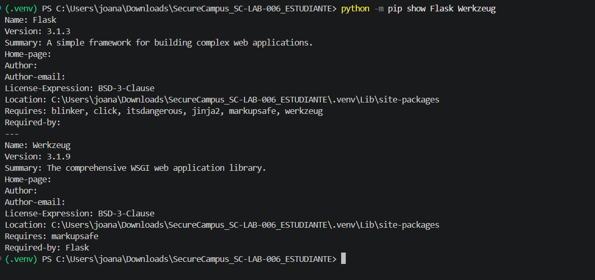

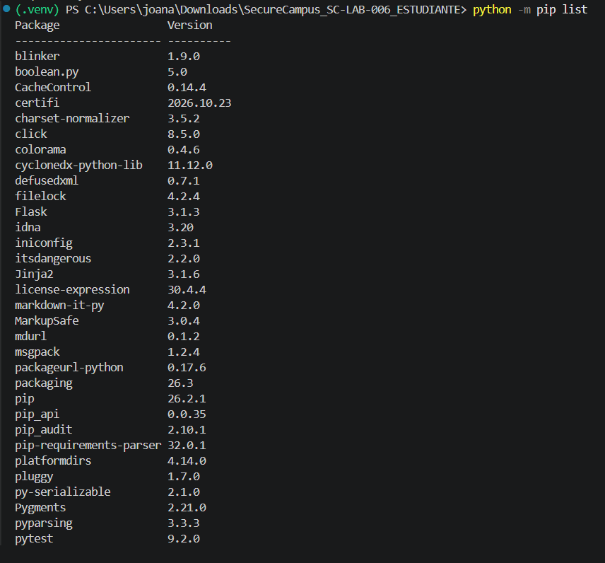

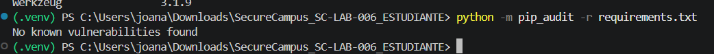

# 10. Actividad F: CI/CD (2.7)

Crea una rama, realiza cambios, abre un Pull Request y revisa .github/workflows/security.yml. El pipeline ejecuta pytest y pip-audit. Si falla, analiza el resultado y corrige el problema antes de integrar. No agregues secretos al YAML.

Importante: el workflow educativo usa etiquetas de versiones mayores de acciones. En un proyecto de producción se fijarían acciones a SHA completos verificados, además de aplicar protección de ramas y revisión de cambios.

# 11. Evidencias y reflexión individual

E1. Matriz de permisos y diagrama de arquitectura:

\_\_\_\_\_\_\_\_\_\_\_\_\_\_\_\_\_\_\_\_\_\_\_\_\_\_\_\_\_\_\_\_\_\_\_\_\_\_\_\_\_\_\_\_\_\_\_\_\_\_\_\_\_\_\_\_\_\_\_\_\_\_\_\_\_\_\_\_\_\_\_\_\_\_\_\_\_\_\_\_

E2. Captura de pytest antes y después:

\_\_\_\_\_\_\_\_\_\_\_\_\_\_\_\_\_\_\_\_\_\_\_\_\_\_\_\_\_\_\_\_\_\_\_\_\_\_\_\_\_\_\_\_\_\_\_\_\_\_\_\_\_\_\_\_\_\_\_\_\_\_\_\_\_\_\_\_\_\_\_\_\_\_\_\_\_\_\_\_

E3. Captura de pruebas de acceso denegado:

\_\_\_\_\_\_\_\_\_\_\_\_\_\_\_\_\_\_\_\_\_\_\_\_\_\_\_\_\_\_\_\_\_\_\_\_\_\_\_\_\_\_\_\_\_\_\_\_\_\_\_\_\_\_\_\_\_\_\_\_\_\_\_\_\_\_\_\_\_\_\_\_\_\_\_\_\_\_\_\_

E4. Explicación de contraseñas, sesiones y CSRF:

\_\_\_\_\_\_\_\_\_\_\_\_\_\_\_\_\_\_\_\_\_\_\_\_\_\_\_\_\_\_\_\_\_\_\_\_\_\_\_\_\_\_\_\_\_\_\_\_\_\_\_\_\_\_\_\_\_\_\_\_\_\_\_\_\_\_\_\_\_\_\_\_\_\_\_\_\_\_\_\_

E5. Auditoría de dependencias y propuesta de archivos:

\_\_\_\_\_\_\_\_\_\_\_\_\_\_\_\_\_\_\_\_\_\_\_\_\_\_\_\_\_\_\_\_\_\_\_\_\_\_\_\_\_\_\_\_\_\_\_\_\_\_\_\_\_\_\_\_\_\_\_\_\_\_\_\_\_\_\_\_\_\_\_\_\_\_\_\_\_\_\_\_

E6. Captura del pipeline y enlace al PR:

\_\_\_\_\_\_\_\_\_\_\_\_\_\_\_\_\_\_\_\_\_\_\_\_\_\_\_\_\_\_\_\_\_\_\_\_\_\_\_\_\_\_\_\_\_\_\_\_\_\_\_\_\_\_\_\_\_\_\_\_\_\_\_\_\_\_\_\_\_\_\_\_\_\_\_\_\_\_\_\_

Reflexión: ¿qué control fue más difícil? ¿Qué prueba te dio mayor confianza? ¿Qué falta antes de producción?

# 12. Rúbrica resumida (100 puntos)

| Criterio                             | Puntos |
|--------------------------------------|--------|
| 2.1 Diseño seguro                    | 10     |
| 2.2 Arquitectura resiliente          | 10     |
| 2.3 Validación                       | 15     |
| 2.4 Sesiones y acceso                | 20     |
| 2.5 Criptografía                     | 10     |
| 2.6 Dependencias, archivos y errores | 15     |
| 2.7 CI/CD                            | 15     |
| Documentación y defensa              | 5      |
