GUÍA DEL ESTUDIANTE · Tema 3 · Seguridad en aplicaciones web y APIs

Modalidad: demostración guiada paso a paso. No se requiere desarrollar una API desde cero. Duración sugerida: 5 horas prácticas, más 3 horas de fundamentos y discusión. Proyecto: SecureCampus.

# 1. ¿Qué aprenderás?

Al finalizar podrás iniciar una API local en Python, usar una interfaz web para enviar solicitudes REST y GraphQL, interpretar JSON y códigos HTTP, comparar accesos permitidos y denegados, y reconocer por qué la autorización debe comprobarse en el servidor.

# 2. Material que recibirás

Un archivo ZIP con el proyecto SecureCampus ya preparado: aplicación Flask, base SQLite con datos ficticios, interfaz visual accesible desde el navegador, servicio REST, consulta GraphQL y pruebas pytest. No necesitas crear estos archivos.

# 3. Requisitos previos

Windows, Python 3 instalado, Visual Studio Code, navegador web y conexión a Internet solo para instalar paquetes la primera vez. Se trabaja exclusivamente en localhost; no es necesario Docker ni una cuenta de GitHub.

# 4. Preparar la carpeta en VS Code

Paso 1. Descomprime el ZIP en C:\Proyectos\SecureCampus_SC-LAB-007. Paso 2. En Visual Studio Code elige Archivo \> Abrir carpeta y selecciona esa carpeta. Paso 3. Abre Terminal \> Nueva terminal. Debes ver la ruta del proyecto.

# 5. Crear y activar el entorno virtual

> python -m venv .venv
>
> .\\.venv\Scripts\Activate.ps1

Verificación: la terminal comienza con (.venv). Si PowerShell bloquea la activación, escribe Set-ExecutionPolicy -Scope Process Bypass y repite la activación. Esta excepción solo dura la sesión de terminal.

# 6. Instalar los paquetes

> python -m pip install -r requirements.txt -r requirements-dev.txt

Espera a que finalice. Flask atiende solicitudes web, graphql-core procesa consultas GraphQL y pytest comprueba el comportamiento de seguridad.

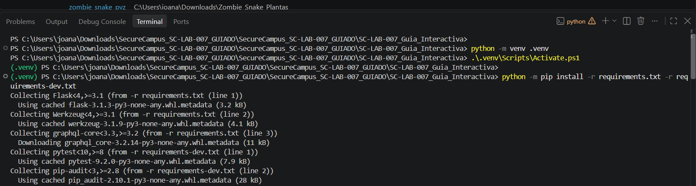

# 7. Ejecutar SecureCampus

> python run.py

Abre el navegador y escribe la dirección local: http://127.0.0.1:5000. Deberás ver una pantalla con tres secciones: iniciar sesión, API REST y API GraphQL. Mantén abierta la terminal mientras realizas la actividad.

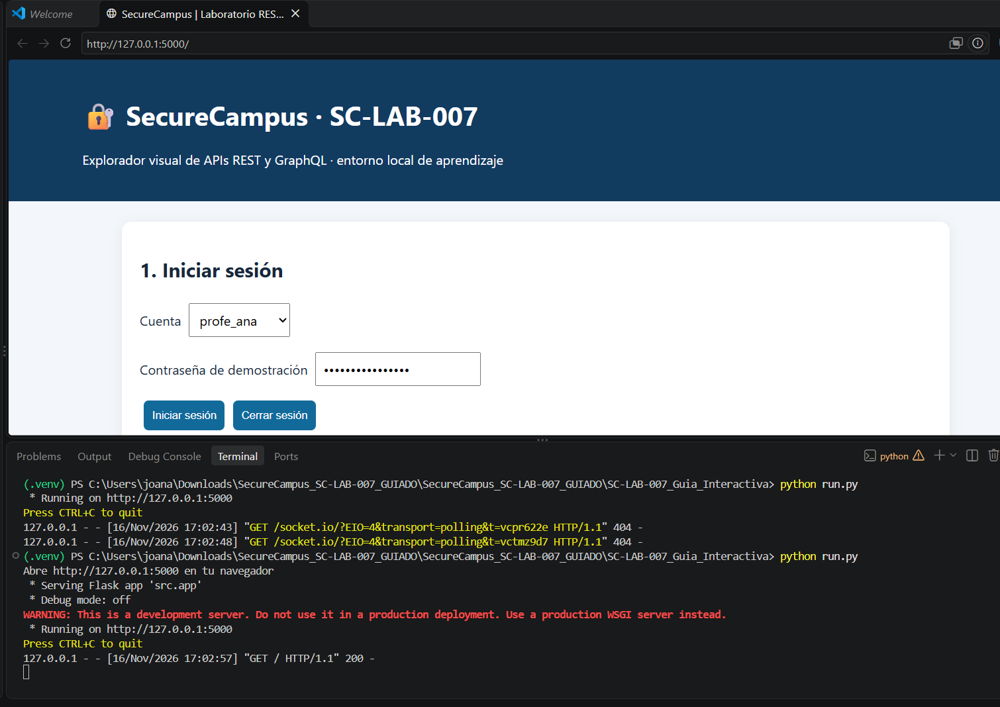

# 8. Conocer la interfaz visual

| Zona | Qué hace |
|----|----|
| Inicio de sesión | Autentica una cuenta ficticia y guarda la sesión en una cookie HTTP-only. |
| REST | Envía GET para consultar y PUT para modificar una calificación. |
| GraphQL | Envía una consulta con los campos elegidos y muestra la respuesta. |
| Resultados | Muestra el código HTTP y el cuerpo JSON de la respuesta. |

# 9. Datos ficticios del laboratorio

| Cuenta     | Rol        | Grupo       |
|------------|------------|-------------|
| profe_ana  | Profesor   | ISC401 (10) |
| profe_luis | Profesor   | ISC402 (20) |
| alumna_eli | Estudiante | ISC401 (10) |
| alumno_paz | Estudiante | ISC402 (20) |

Contraseña para todas las cuentas de demostración: Laboratorio2026! \| Eli: ID 3; Paz: ID 4. No utilices contraseñas personales.

# 10. Experiencia guiada A: REST GET

Paso 1. Selecciona profe_ana, conserva la contraseña de demostración y pulsa Iniciar sesión. Paso 2. En REST coloca estudiante 3 y grupo 10. Paso 3. Pulsa GET · Consultar. Observa HTTP 200 y el JSON de la calificación. Paso 4. Cambia a estudiante 4 y grupo 20. Pulsa GET. Observa HTTP 403: Ana no pertenece al grupo 20.

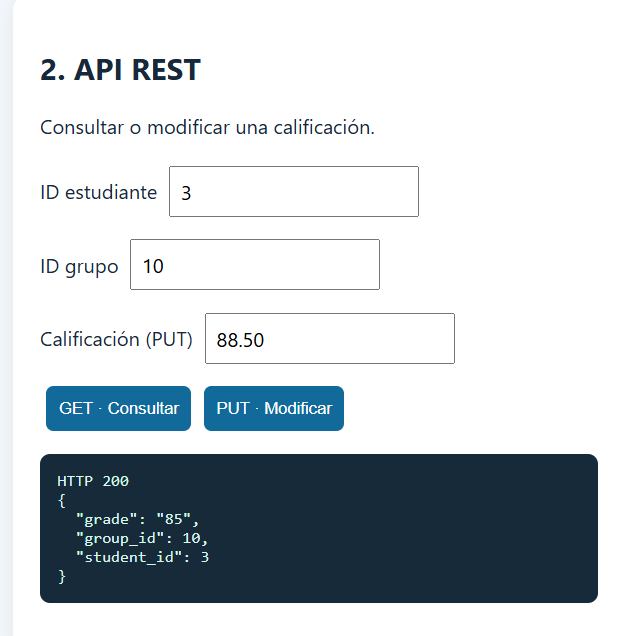 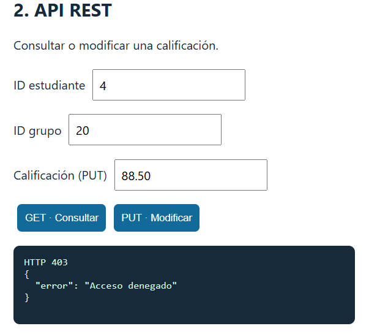

Anota: ¿qué cambia entre ambas solicitudes? ¿Por qué la autenticación por sí sola no basta?

# 11. Experiencia guiada B: REST PUT

Paso 1. Con Ana autenticada, coloca estudiante 3, grupo 10 y calificación 88.50. Paso 2. Pulsa PUT · Modificar: debe responder HTTP 200. Paso 3. Pulsa GET y verifica el nuevo valor. Paso 4. Cambia a estudiante 4 y grupo 20: el PUT debe responder 403. Paso 5. Vuelve a 3/10, escribe 150 y pulsa PUT: debe responder 400 por entrada inválida.

Nota: el PUT requiere un token CSRF que la interfaz obtiene al iniciar sesión. El token se envía en la cabecera X-CSRF-Token.

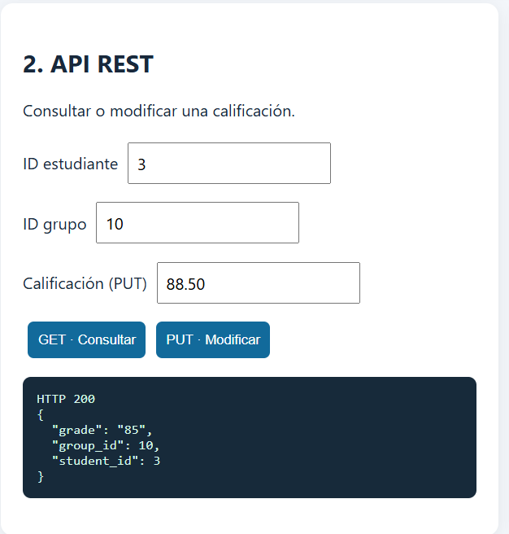 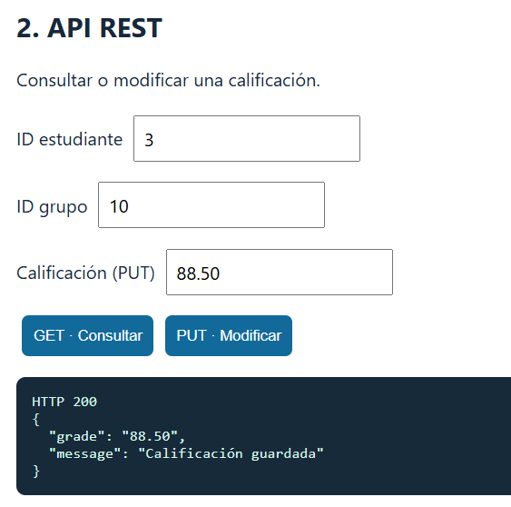 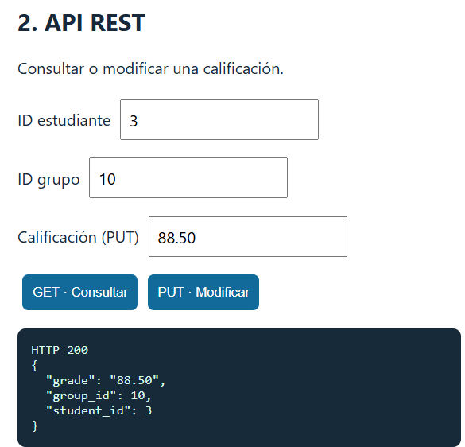

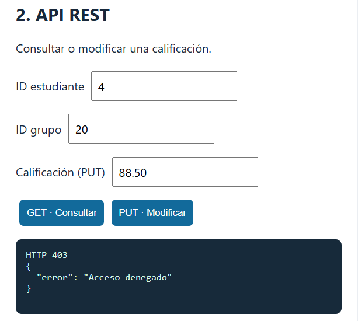 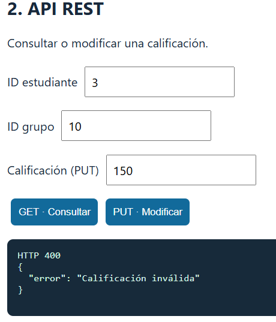

# 12. Experiencia guiada C: estudiante y control de acceso

Paso 1. Cierra sesión. Paso 2. Inicia sesión como alumna_eli. Paso 3. Consulta 3/10 con GET: debe devolver 200. Paso 4. Consulta 4/20: debe devolver 403. Paso 5. Intenta modificar 3/10 con PUT: debe devolver 403. Explica por qué ser dueño de una calificación no autoriza a cambiarla.

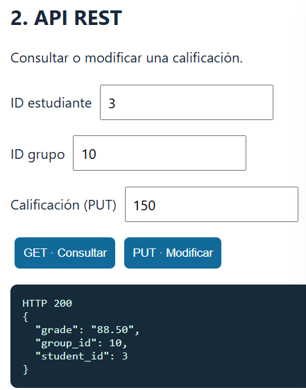 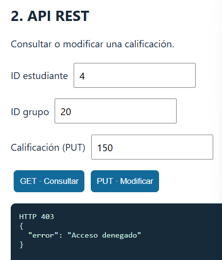 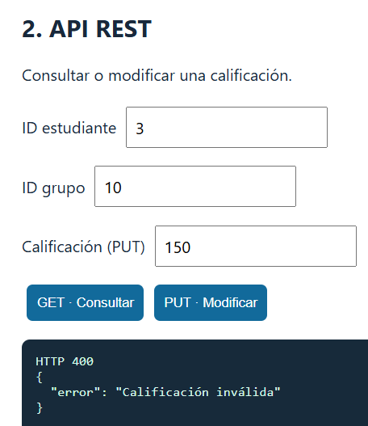

# 13. Experiencia guiada D: GraphQL

Con Eli autenticada, copia esta consulta en el cuadro GraphQL y pulsa Ejecutar GraphQL:

> query { grade(studentId: 3, groupId: 10) { studentId groupId grade } }

Se espera HTTP 200 con data.grade. Ahora cambia studentId: 4 y groupId: 20. Se espera HTTP 403 con un error de acceso denegado. La autorización se aplica también en GraphQL, no solo en REST.

Prueba adicional: elimina studentId y groupId del bloque de selección, dejando solo grade. GraphQL devuelve únicamente los campos solicitados.

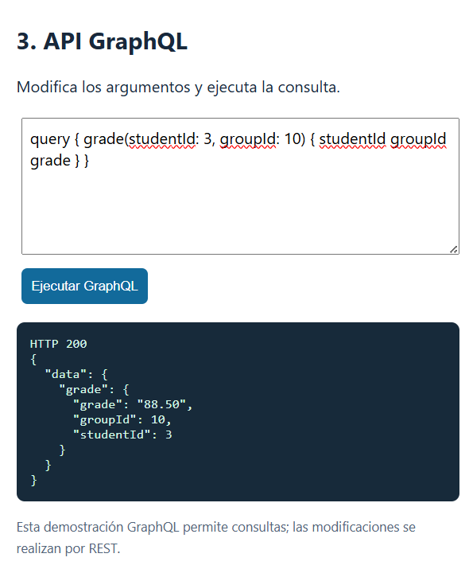

# 14. REST y GraphQL: ¿qué diferencia observaste?

| REST | GraphQL |
|----|----|
| La ruta identifica el recurso: /grades/3/10. | La consulta indica el recurso y los campos deseados. |
| GET consulta; PUT modifica. | En este laboratorio solo implementamos consultas. |
| Responde con JSON. | Responde con JSON bajo la clave data o errors. |
| El servidor debe verificar permisos. | El resolver también debe verificar permisos. |

# 15. Ejecutar las pruebas automatizadas

Detén el servidor con Ctrl+C. En la misma terminal, ejecuta:

> python -m pytest -q

En el paquete entregado se esperan 18 pruebas aprobadas (15 del laboratorio previo y 3 nuevas). Si aparece un fallo, comparte la salida completa con la profesora antes de modificar el código.

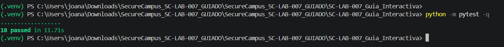

# 16. ¿Qué evidencia entregarás?

Una sola hoja o presentación breve con: (a) captura de la interfaz REST con 200; (b) captura de REST con 403; (c) captura de GraphQL con 200 y 403; (d) captura del resultado pytest; (e) respuestas de las preguntas de reflexión. Se valora la comprensión, no escribir código nuevo.

# 17. Preguntas de reflexión

• ¿Qué significa 200, 400, 401 y 403?

• ¿Qué diferencia existe entre iniciar sesión y tener autorización?

• ¿Por qué una persona no debe poder consultar calificaciones de otros estudiantes cambiando los identificadores?

• ¿Qué cambia al consultar una calificación por REST o por GraphQL?

• ¿Qué pasaría si GraphQL omitiera la comprobación de permisos?

# 18. Problemas frecuentes y solución

| Situación | Qué revisar |
|----|----|
| No se reconoce python | Verifica instalación y que Python esté en PATH. |
| No aparece (.venv) | Activa el entorno virtual en la terminal del proyecto. |
| ModuleNotFoundError | Instala requirements.txt y requirements-dev.txt dentro de .venv. |
| No abre la página | Confirma que python run.py sigue ejecutándose y usa http://127.0.0.1:5000. |
| Puerto 5000 ocupado | Cierra otra aplicación que use el puerto; consulta a la profesora. |
| Respuesta 401 | Inicia sesión antes de consultar. |
| Respuesta 403 | Revisa si la cuenta tiene permiso para ese estudiante y grupo. |
| Respuesta 400 | Revisa los datos enviados o la sintaxis de la consulta. |

# 19. Seguridad y alcance de la demostración

El proyecto es exclusivamente educativo, utiliza usuarios y calificaciones ficticias y debe ejecutarse solo en la computadora local. No es un sistema institucional de producción. GraphQL solo admite consulta; no se incorpora un cliente móvil ni despliegue público. No subas la base de datos ni contraseñas reales a repositorios.

Cierre: Has usado una API REST y una API GraphQL sin construirlas desde cero. El siguiente laboratorio abordará riesgos móviles y despliegue seguro en contenedores.
