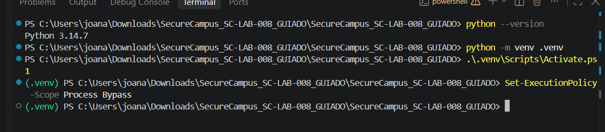
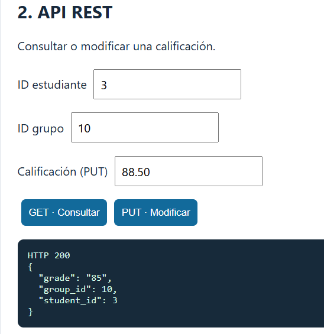
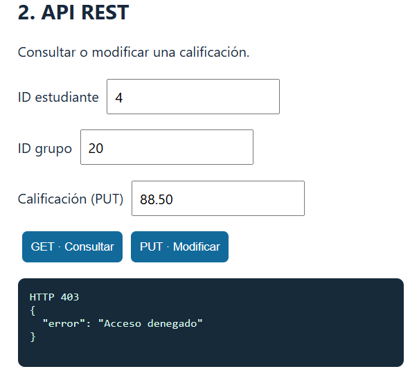
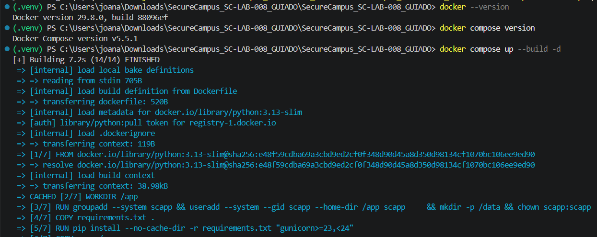
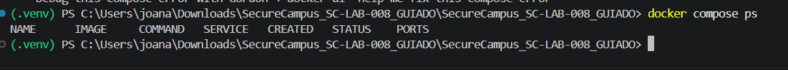
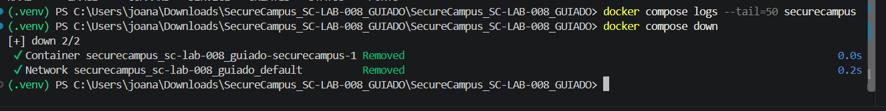
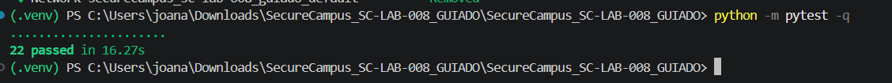

Guía paso a paso • Sin programar desde cero • Python, Visual Studio Code y Docker Desktop

# Antes de comenzar

Este laboratorio continúa SC-LAB-007. La interfaz móvil es una simulación educativa realizada en el navegador; no es una aplicación Android nativa. Trabajaremos con cuentas y calificaciones ficticias. La profesora dirige la demostración y los estudiantes repiten exactamente los pasos.

# Parte A · Simulador de seguridad móvil (sin Docker)

## Paso 1. Preparar la carpeta de trabajo

1\) Descarga SecureCampus_SC-LAB-008_GUIADO.zip. 2) Descomprímelo en C:\Proyectos. 3) Abre la carpeta SecureCampus_SC-LAB-008_GUIADO en Visual Studio Code. 4) Selecciona Terminal \> Nueva terminal.

## Paso 2. Crear un entorno virtual

> python --version\
> python -m venv .venv\
> .\\.venv\Scripts\Activate.ps1

Resultado esperado: aparece (.venv) a la izquierda del indicador de PowerShell. Si se bloquea la activación, ejecuta Set-ExecutionPolicy -Scope Process Bypass y repite el comando anterior.

## Paso 3. Instalar y ejecutar

> python -m pip install -r requirements.txt -r requirements-dev.txt\
> python run.py

En el navegador visita http://127.0.0.1:5000/mobile-demo. La aplicación se ejecuta solamente en tu computadora. Deja la terminal del servidor abierta durante los ejercicios.

## Paso 4. Experimentar con almacenamiento local ficticio

En el simulador pulsa «Guardar marcador ficticio» y después «Inspeccionar almacenamiento». Recarga la página y vuelve a inspeccionar. Finalmente pulsa «Eliminar marcador». El texto almacenado no es un token real y no permite iniciar sesión.

| Acción           | Observación esperada                             |
|------------------|--------------------------------------------------|
| Guardar marcador | Aparece DEMO-NO-ES-UN-TOKEN-REAL en localStorage |
| Recargar         | El marcador persiste hasta eliminarlo            |
| Eliminar         | El resultado cambia a null                       |

Explicación: localStorage se puede leer con JavaScript del mismo origen; por eso no debe utilizarse como lugar para guardar contraseñas o secretos sensibles. En la aplicación, la sesión verdadera se conserva en una cookie HttpOnly, no en el marcador.

## Paso 5. Demostrar autorización desde un cliente móvil

Abre otra pestaña con http://127.0.0.1:5000/. Inicia sesión como alumna_eli usando exclusivamente la contraseña ficticia de laboratorio: Laboratorio2026!. Regresa al simulador móvil. Pulsa «Consultar 3/10» y luego «Consultar 4/20».

| Acción | Resultado esperado | Por qué |
|----|----|----|
| Eli consulta 3/10 | HTTP 200 | Consulta su propia calificación |
| Eli consulta 4/20 | HTTP 403 | La calificación pertenece a otra persona |
| Sin sesión | HTTP 401 | Autenticación requerida |

Conclusión: ocultar botones en un cliente móvil NO sustituye la autorización en el servidor. La API verifica al usuario en cada solicitud.

 

## Paso 6. Comprobar HTTP y comprender HTTPS

Pulsa «Comprobar dirección actual». Deberás observar «http:» y el host 127.0.0.1:5000. Esto es válido solamente para la demostración local. Para uso real con credenciales o datos personales se requiere HTTPS/TLS. NO intentes probar contraseñas reales ni interceptar tráfico de redes ajenas.

# Parte B · Contenedores con Docker Desktop

## Paso 7. Conocer las piezas de Docker

| Elemento | Significado en el laboratorio |
|----|----|
| Dockerfile | Instrucciones para crear la imagen de SecureCampus |
| Imagen | Paquete con Python, dependencias y aplicación |
| Contenedor | Proceso aislado que ejecuta la imagen |
| compose.yaml | Configuración para arrancar el servicio con un comando |
| Volumen | Lugar persistente para la base SQLite de demostración |
| Puerto 127.0.0.1:5000 | Acceso solamente desde la propia computadora |

## Paso 8. Revisar las protecciones del proyecto

Abre Dockerfile y compose.yaml en VS Code. Identifica: USER scapp (no administrador), read_only: true (raíz de solo lectura), cap_drop: ALL (reduce capacidades), no-new-privileges:true, tmpfs /tmp, volumen /data, y publicación de puerto 127.0.0.1:5000. Marca cada configuración al encontrarla.

Advertencia didáctica: SC_COOKIE_SECURE=0 se usa únicamente porque esta práctica corre por HTTP en localhost. En producción NO es apropiado: se requiere HTTPS y cookies Secure. El laboratorio NO está preparado para publicar en Internet.

## Paso 9. Iniciar el contenedor (si Docker está instalado)

Instala y abre Docker Desktop antes de esta etapa. Detén el servidor Python de la Parte A con Ctrl+C, pues ambos utilizan el puerto 5000. Después, desde la carpeta del proyecto, escribe:

> docker --version\
> docker compose version\
> docker compose up --build -d\
> docker compose ps

Cuando el servicio esté disponible, abre http://127.0.0.1:5000/mobile-demo. La interfaz debe verse como antes; la diferencia es que ahora Python se ejecuta dentro del contenedor.

## Paso 10. Verificar, observar y detener

> docker compose logs --tail=50 securecampus\
> docker compose down

«down» detiene y elimina el contenedor, pero conserva el volumen. Para borrar también los datos ficticios del volumen, solo si lo autoriza la profesora: docker compose down -v.

## Ruta alternativa sin Docker

Si el equipo no dispone de Docker Desktop, realiza íntegramente los pasos 1 a 8, estudia los archivos Dockerfile y compose.yaml, y entrega una tabla de riesgos. No reportes la ejecución de un contenedor que no ejecutaste.

# Parte C · Comprobación y evidencias

## Paso 11. Ejecutar pruebas automatizadas

Con el entorno virtual activo, ejecuta el siguiente comando en la carpeta principal del proyecto (el servidor puede estar detenido):

> python -m pytest -q

La versión entregada incorpora cuatro pruebas nuevas, además de las pruebas de SC-LAB-007. Se esperan 22 pruebas aprobadas si están instaladas todas las dependencias y no se modificó el código.

## Paso 12. Completar el registro de observaciones

| Situación observada | Riesgo | Control propuesto |
|----|----|----|
| Marcador en localStorage | Un dato accesible desde JavaScript podría exponerse | Evitar secretos en almacenamiento accesible a scripts |
| Consulta a calificación ajena | Exposición de información académica | Autorización en el servidor (HTTP 403) |
| HTTP local | El tráfico no utiliza TLS | Exigir HTTPS/TLS en entornos reales |
| Contenedor con usuario root | Exceso de privilegios | Ejecutar como usuario no privilegiado |
| Base de datos dentro de imagen | Riesgo de persistencia y filtración | Usar volumen y excluir .db de la imagen |

# Entregables y evaluación

Entreguen un único PDF o documento con: 1) captura del simulador móvil; 2) resultados HTTP 200/403; 3) comprobación del protocolo; 4) configuración Docker identificada; 5) salida de pytest; 6) tres conclusiones propias. Si no ejecutaron Docker, expliquen la limitación y adjunten análisis de configuración.

| Criterio                                      | Puntos |
|-----------------------------------------------|--------|
| Seguimiento de pasos y uso de la interfaz     | 20     |
| Explicación de riesgos móviles y autorización | 30     |
| Análisis de Docker y controles de seguridad   | 25     |
| Evidencias y resultados de pruebas            | 15     |
| Conclusiones y claridad del reporte           | 10     |
| TOTAL                                         | 100    |

# Solución de problemas frecuentes

| Síntoma | Acción sugerida |
|----|----|
| No aparece (.venv) | Verifica la carpeta y repite la activación; en PowerShell usa permiso por proceso si hace falta |
| Falla al instalar paquetes | Comprueba conexión y usa python -m pip; no copies comandos dentro del intérprete \>\>\> |
| Puerto 5000 ocupado | Detén otra instancia de python run.py o docker compose down |
| HTTP 401 | Inicia sesión en la página principal antes de consultar desde el simulador |
| Docker no responde | Abre Docker Desktop y espera a que se inicie el motor |
| Cambios en datos de prueba | Elimina la base local con servidor detenido o reinicia volumen de Docker solamente con autorización |

Nota de alcance: este laboratorio no desarrolla aplicaciones móviles nativas ni implementa infraestructura de nube pública. Simula los riesgos de cliente móvil y utiliza Docker local para estudiar controles que también se aplican a despliegues en nube.
