**SC-LAB-004**

Análisis de Seguridad Estático y Dinámico\
SAST + DAST

**Manual del Alumno**

SecureCampus Security Lab · versión 1.0 · septiembre 2026

<table>
<colgroup>
<col style="width: 100%" />
</colgroup>
<thead>
<tr>
<th><strong>Pregunta guía 
</strong>¿Qué puede descubrir una herramienta al analizar el código fuente y qué puede descubrir al interactuar con una aplicación en ejecución?</th>
</tr>
</thead>
<tbody>
</tbody>
</table>

# 1. Propósito y resultados de aprendizaje

Analizar una miniaplicación de SecureCampus con técnicas SAST y DAST, interpretar evidencia, corregir dos vulnerabilidades deliberadas y comprobar las correcciones mediante reanálisis.

- Distinguir SAST de DAST por objeto de análisis, momento de ejecución y evidencia.

- Ejecutar Semgrep sobre código Python y OWASP ZAP sobre una aplicación Flask local.

- Interpretar hallazgos sin asumir que 0 findings, PASS o WARN equivalen a una garantía absoluta.

- Corregir una construcción SQL insegura mediante consulta parametrizada.

- Validar y corregir XSS reflejado mediante output escaping y retesting.

- Registrar trazabilidad técnica con Git.

# 2. Requisitos del laboratorio

| **Componente** | **Requisito**                              |
|----------------|--------------------------------------------|
| Sistema        | Windows + PowerShell + VS Code             |
| Git            | Repositorio local SecureCampus-SecurityLab |
| Python         | Python 3.14.x y entorno .venv              |
| Web            | Flask 3.x                                  |
| Docker         | Docker Desktop con Engine activo           |
| SAST           | Semgrep Community mediante contenedor      |
| DAST           | OWASP ZAP mediante contenedor              |

<table>
<colgroup>
<col style="width: 100%" />
</colgroup>
<thead>
<tr>
<th><strong>Regla de seguridad 
</strong>Todos los escaneos activos de esta práctica se realizan únicamente contra la aplicación local deliberadamente vulnerable del laboratorio. No se deben dirigir contra sistemas externos o sin autorización.</th>
</tr>
</thead>
<tbody>
</tbody>
</table>

# 3. Preparación

<table>
<colgroup>
<col style="width: 100%" />
</colgroup>
<thead>
<tr>
<th>cd C:\Users\marel\SecureCampus-SecurityLab 
.\.venv\Scripts\Activate.ps1 
git status 
docker info</th>
</tr>
</thead>
<tbody>
</tbody>
</table>

La estructura mínima esperada incluye src/, tests/, docs/security/, .gitignore y requirements.txt.

# 4. Parte A · SAST con Semgrep

## 4.1 Analiza primero como desarrollador

Revisa el archivo src/app.py. Identifica: entrada controlada por usuario, flujo de datos, operación sensible y posibles problemas. No ejecutes aún la herramienta.

| **Pregunta** | **Respuesta del equipo** |
|----|----|
| ¿Qué dato controla el usuario? | \_\_\_\_\_\_\_\_\_\_\_\_\_\_\_\_\_\_\_\_\_\_\_\_\_\_\_\_\_\_\_\_\_\_\_\_\_\_\_\_ |
| ¿A dónde llega ese dato? | \_\_\_\_\_\_\_\_\_\_\_\_\_\_\_\_\_\_\_\_\_\_\_\_\_\_\_\_\_\_\_\_\_\_\_\_\_\_\_\_ |
| ¿Qué riesgo observas? | \_\_\_\_\_\_\_\_\_\_\_\_\_\_\_\_\_\_\_\_\_\_\_\_\_\_\_\_\_\_\_\_\_\_\_\_\_\_\_\_ |
| ¿Qué control propondrías? | \_\_\_\_\_\_\_\_\_\_\_\_\_\_\_\_\_\_\_\_\_\_\_\_\_\_\_\_\_\_\_\_\_\_\_\_\_\_\_\_ |

## 4.2 Ejecuta Semgrep

| docker run --rm -v "\${PWD}:/src" semgrep/semgrep semgrep scan --config auto /src/src |
|----|

Registra el hallazgo principal. Observa la relación source → flow → sink y la línea señalada por la herramienta.

| **Evidencia SAST** | **Registro** |
|----|----|
| Regla/hallazgo | \_\_\_\_\_\_\_\_\_\_\_\_\_\_\_\_\_\_\_\_\_\_\_\_\_\_\_\_\_\_\_\_\_\_\_\_\_\_\_\_ |
| Archivo/línea | \_\_\_\_\_\_\_\_\_\_\_\_\_\_\_\_\_\_\_\_\_\_\_\_\_\_\_\_\_\_\_\_\_\_\_\_\_\_\_\_ |
| ¿Qué evidencia aporta? | \_\_\_\_\_\_\_\_\_\_\_\_\_\_\_\_\_\_\_\_\_\_\_\_\_\_\_\_\_\_\_\_\_\_\_\_\_\_\_\_ |
| ¿Coincide con tu análisis humano? | \_\_\_\_\_\_\_\_\_\_\_\_\_\_\_\_\_\_\_\_\_\_\_\_\_\_\_\_\_\_\_\_\_\_\_\_\_\_\_\_ |

## 4.3 Corrige y reanaliza

Sustituye la concatenación de datos dentro del SQL por una consulta parametrizada:

<table>
<colgroup>
<col style="width: 100%" />
</colgroup>
<thead>
<tr>
<th>consulta = ( 
"SELECT id, nombre, correo " 
"FROM estudiantes " 
"WHERE nombre = ?" 
) 
cursor.execute(consulta, (nombre,))</th>
</tr>
</thead>
<tbody>
</tbody>
</table>

Ejecuta nuevamente Semgrep y registra el resultado. Un resultado de 0 findings significa que las reglas ejecutadas no reportaron hallazgos en ese momento; no significa que toda la aplicación sea segura.

# 5. Parte B · DAST con OWASP ZAP

## 5.1 Inicia la aplicación

| python src\webapp.py |
|----------------------|

Mantén Flask ejecutándose en una terminal. En otra terminal comprueba que un contenedor Docker pueda llegar al servicio:

| docker run --rm curlimages/curl http://host.docker.internal:5000 |
|------------------------------------------------------------------|

## 5.2 Baseline: observación pasiva

| docker run --rm -t ghcr.io/zaproxy/zaproxy:stable zap-baseline.py -t http://host.docker.internal:5000 |
|----|

Registra los WARN principales. No corrijas automáticamente todo lo que aparezca: primero interpreta contexto, evidencia y aplicabilidad.

| **Hallazgo baseline** | **¿Qué observa?** | **¿Requiere análisis?** |
|----|----|----|
| Missing Anti-clickjacking Header | Cabecera HTTP | Sí |
| X-Content-Type-Options Header Missing | Cabecera HTTP | Sí |
| CSP Header Not Set | Política de contenido | Sí |
| Otro: | \_\_\_\_\_\_\_\_\_\_\_\_\_\_\_\_ | \_\_\_\_\_\_\_\_\_\_\_\_\_\_\_\_ |

## 5.3 Active Scan: interacción deliberada

| docker run --rm -t ghcr.io/zaproxy/zaproxy:stable zap-full-scan.py -t http://host.docker.internal:5000 |
|----|

Localiza Cross Site Scripting (Reflected) \[40012\]. Observa el endpoint /buscar?nombre=... y el código HTTP devuelto. Recuerda: una vulnerabilidad puede existir aunque la respuesta sea 200 OK.

## 5.4 Validación manual del XSS

En la aplicación local, introduce como nombre:

| \<script\>alert(1)\</script\> |
|-------------------------------|

Si aparece una ventana alert(1), registra la evidencia como confirmación manual del comportamiento vulnerable.

## 5.5 Registra la línea base vulnerable en Git

<table>
<colgroup>
<col style="width: 100%" />
</colgroup>
<thead>
<tr>
<th>git add src/webapp.py 
git diff --staged 
git commit -m "lab: agregar aplicacion vulnerable para analisis DAST" 
git status</th>
</tr>
</thead>
<tbody>
</tbody>
</table>

## 5.6 Corrige el XSS

Evita insertar directamente la entrada del usuario con un f-string. Renderiza el valor como variable de plantilla para aplicar escaping:

<table>
<colgroup>
<col style="width: 100%" />
</colgroup>
<thead>
<tr>
<th>resultado_html = """ 
... 
&lt;p&gt;Estudiante buscado: {{ nombre }}&lt;/p&gt; 
... 
""" 
return render_template_string(resultado_html, nombre=nombre)</th>
</tr>
</thead>
<tbody>
</tbody>
</table>

Reinicia Flask antes del retest. Este paso es obligatorio: modificar el archivo no garantiza que la instancia en ejecución ya contenga el cambio.

## 5.7 Retesting

- Prueba una búsqueda normal: María debe seguir funcionando.

- Repite \<script\>alert(1)\</script\>: debe mostrarse como texto y no ejecutarse.

- Ejecuta nuevamente zap-full-scan.py.

- Comprueba que Cross Site Scripting (Reflected) \[40012\] pase de WARN a PASS.

- Observa qué advertencias permanecen y explica por qué no desaparecieron.

# 6. Comparación SAST vs DAST

| **Criterio** | **SAST** | **DAST** |
|----|----|----|
| Objeto | Código fuente | Aplicación en ejecución |
| Necesita ejecutar app | No | Sí |
| Perspectiva | Interna/estática | Externa/dinámica |
| Evidencia del lab | Construcción SQL insegura | XSS y configuración HTTP |
| Fortaleza | Detecta patrones/rutas en código | Observa comportamiento real expuesto |
| Límite | No garantiza lógica de negocio | No ve todo el código ni todas las rutas |

# 7. Evidencia y entrega en GitHub

Crea docs/security/SC-LAB-004-sast-dast.md e incluye: objetivo, entorno, análisis humano, comando y hallazgo SAST, corrección y reanálisis, baseline DAST, active scan, validación manual, corrección XSS, retesting y comparación final.

<table>
<colgroup>
<col style="width: 100%" />
</colgroup>
<thead>
<tr>
<th>git status 
git diff 
git add src/webapp.py docs/security/SC-LAB-004-sast-dast.md 
git diff --staged 
git commit -m "fix: aplicar escape de salida para prevenir XSS reflejado" 
git push 
git status</th>
</tr>
</thead>
<tbody>
</tbody>
</table>

# 8. Reflexión

1\. ¿Por qué 0 findings en SAST no equivale a aplicación segura?

\_\_\_\_\_\_\_\_\_\_\_\_\_\_\_\_\_\_\_\_\_\_\_\_\_\_\_\_\_\_\_\_\_\_\_\_\_\_\_\_\_\_\_\_\_\_\_\_\_\_\_\_\_\_\_\_\_\_\_\_\_\_\_\_\_\_\_\_\_\_\_\_\_\_\_\_\_\_\_\_

2\. ¿Por qué un WARN de ZAP debe validarse antes de declararlo vulnerabilidad?

\_\_\_\_\_\_\_\_\_\_\_\_\_\_\_\_\_\_\_\_\_\_\_\_\_\_\_\_\_\_\_\_\_\_\_\_\_\_\_\_\_\_\_\_\_\_\_\_\_\_\_\_\_\_\_\_\_\_\_\_\_\_\_\_\_\_\_\_\_\_\_\_\_\_\_\_\_\_\_\_

3\. ¿Qué diferencia observaste entre baseline y active scan?

\_\_\_\_\_\_\_\_\_\_\_\_\_\_\_\_\_\_\_\_\_\_\_\_\_\_\_\_\_\_\_\_\_\_\_\_\_\_\_\_\_\_\_\_\_\_\_\_\_\_\_\_\_\_\_\_\_\_\_\_\_\_\_\_\_\_\_\_\_\_\_\_\_\_\_\_\_\_\_\_

4\. ¿Por qué 200 OK no descarta una vulnerabilidad?

\_\_\_\_\_\_\_\_\_\_\_\_\_\_\_\_\_\_\_\_\_\_\_\_\_\_\_\_\_\_\_\_\_\_\_\_\_\_\_\_\_\_\_\_\_\_\_\_\_\_\_\_\_\_\_\_\_\_\_\_\_\_\_\_\_\_\_\_\_\_\_\_\_\_\_\_\_\_\_\_

5\. ¿Qué aprendiste del hecho de tener que reiniciar Flask antes del retest?

\_\_\_\_\_\_\_\_\_\_\_\_\_\_\_\_\_\_\_\_\_\_\_\_\_\_\_\_\_\_\_\_\_\_\_\_\_\_\_\_\_\_\_\_\_\_\_\_\_\_\_\_\_\_\_\_\_\_\_\_\_\_\_\_\_\_\_\_\_\_\_\_\_\_\_\_\_\_\_\_

6\. ¿Qué problema de autorización podría seguir existiendo aunque SAST y DAST no lo reporten?

\_\_\_\_\_\_\_\_\_\_\_\_\_\_\_\_\_\_\_\_\_\_\_\_\_\_\_\_\_\_\_\_\_\_\_\_\_\_\_\_\_\_\_\_\_\_\_\_\_\_\_\_\_\_\_\_\_\_\_\_\_\_\_\_\_\_\_\_\_\_\_\_\_\_\_\_\_\_\_\_

# 9. Criterios de aceptación y rúbrica

| **Criterio**                        | **Puntos** |
|-------------------------------------|------------|
| Ejecución e interpretación SAST     | 20         |
| Corrección SQL + reanálisis         | 15         |
| Baseline y Active Scan DAST         | 20         |
| Validación/corrección/retesting XSS | 25         |
| Comparación SAST vs DAST            | 10         |
| Evidencia Git/GitHub y reflexión    | 10         |
| TOTAL                               | 100        |

<table>
<colgroup>
<col style="width: 100%" />
</colgroup>
<thead>
<tr>
<th><strong>Cierre 
</strong>SAST y DAST aportan evidencias diferentes y complementarias. Ninguna herramienta sustituye requisitos de seguridad, revisión humana, pruebas negativas ni validación de autorización y lógica de negocio.</th>
</tr>
</thead>
<tbody>
</tbody>
</table>

# ANEXO DE RESULTADOS Y EVIDENCIAS · PARTICIPACIÓN NAT

Este anexo documenta únicamente las pruebas realizadas sobre el proyecto SecureCampus en Next.js y Firebase. El texto, los apartados y la estructura del manual SC-LAB-004 original se conservan sin modificaciones. Las respuestas de la adaptación se integran aquí para no sustituir los ejercicios demostrativos de Python/Flask incluidos en la plantilla.

## 1. Alcance y entorno (apartados 1–3 del manual)

| **Aspecto** | **Evidencia / delimitación** |
|----|----|
| Herramientas | VS Code y PowerShell en Windows; Docker Desktop y WSL 2; Semgrep Community; OWASP ZAP Baseline. |
| Aplicación | SecureCampus, Next.js 16.3.6, Firebase Authentication y Firestore; ejecución local http://localhost:3000. |
| Carpetas | app/profesor/grupos/; app/jefatura/grupos/; app/estudiante/kardex/; app/estudiante/solicitudes/. |
| Foco de evaluación | RBAC entre estudiante, profesor y jefatura; filtrado de grupos por profesor; acceso al Kárdex y solicitudes. |
| Limitaciones | Sin acceso a Firebase Console para revisar reglas de Firestore; sin escaneo activo ZAP; sin cambio de código, remediación, reanálisis ni Git commit. |

## 2. Parte A · SAST con Semgrep (apartados 4.1–4.3)

Comando empleado por carpeta (sustituyendo RUTA por la carpeta correspondiente): docker run --rm -v "\${PWD}:/src" semgrep/semgrep semgrep scan --config auto /src/RUTA

| **Carpeta**            | **Archivos** | **Reglas ejecutadas** | **Hallazgos** |
|------------------------|--------------|-----------------------|---------------|
| profesor/grupos        | 1            | 210                   | 0             |
| jefatura/grupos        | 1            | 210                   | 0             |
| estudiante/kardex      | 1            | 210                   | 0             |
| estudiante/solicitudes | 1            | 210                   | 0             |

Interpretación: Semgrep terminó correctamente y no notificó coincidencias en los cuatro escaneos separados. Los 0 findings no demuestran que RBAC o las reglas de datos estén libres de errores.

## 2.1 Análisis humano (preguntas del apartado 4.1)

| **Módulo** | **Dato controlado / flujo** | **Riesgo observado y control propuesto** |
|----|----|----|
| Profesor | Rol y sesión del docente; selección de un grupo y navegación con grupoId a calificaciones. Consulta de grupos filtrada por profesorUid. | Lectura completa de inscripciones para conteo. Limitar lecturas a grupos autorizados y verificar la asignación del profesor también en Firestore y en el destino de calificaciones. |
| Jefatura | Datos de grupo: materia, periodo, cupo, horario y profesor. Llegan a operaciones addDoc/updateDoc sobre grupos. | La validación de roles es de cliente. Restringir creación/edición con reglas Firestore para JEFE_CARRERA y ADMIN y validar campos del lado confiable. |
| Kárdex | Sesión y UID del usuario para consultas de inscripciones y calificaciones; grupos se cargan globalmente. | No hay restricción explícita del rol ESTUDIANTE. Verificar rol antes de consultas y limitar acceso a datos propios mediante reglas Firestore. |
| Solicitudes | Tipo y motivo del trámite, junto con UID autenticado; se escriben en solicitudes. | No hay restricción explícita del rol ESTUDIANTE. Verificar rol, propiedad alumnoUid y proteger estatus frente a escritura del estudiante. |

## 2.2 Evidencia SAST (apartado 4.2)

Regla/hallazgo: ninguno reportado por Semgrep. Archivo/línea: un page.tsx por carpeta, sin línea indicada por la herramienta. Coincidencia con revisión humana: parcial, pues las fallas de lógica de autorización no siempre se detectan con reglas genéricas.

<figure>
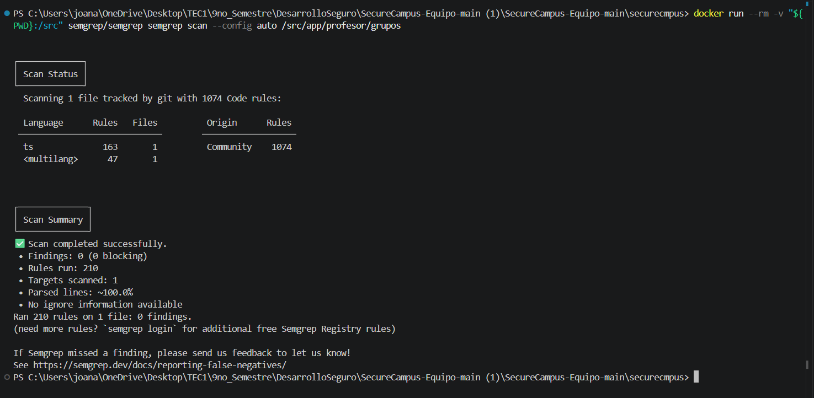
<figcaption>
Evidencia SAST P1 · Profesor / Grupos, 210 reglas, 0 findings
</figcaption>
</figure>

<figure>
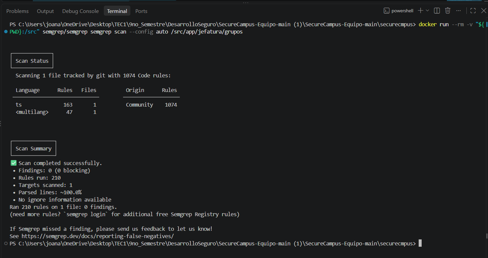
<figcaption>
Evidencia SAST P2 · Jefatura / Grupos, 210 reglas, 0 findings
</figcaption>
</figure>

<figure>
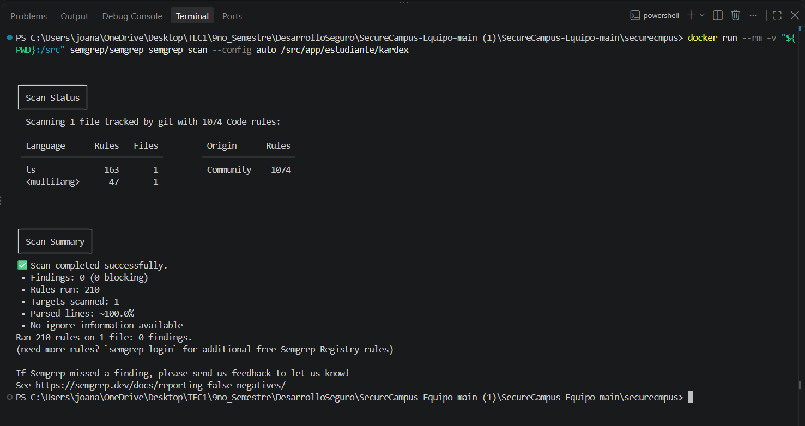
<figcaption>
Evidencia SAST P3 · Estudiante / Kárdex, 210 reglas, 0 findings
</figcaption>
</figure>

<figure>
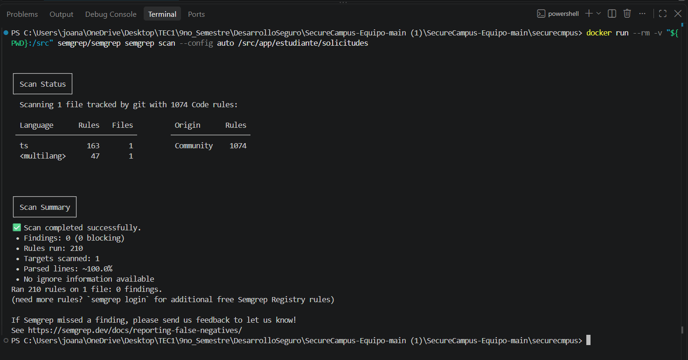
<figcaption>
Evidencia SAST P4 · Estudiante / Solicitudes, 210 reglas, 0 findings
</figcaption>
</figure>

## 2.3 Corrección y reanálisis (apartado 4.3)

No se realizaron modificaciones al proyecto por decisión expresa de la participante. Por tanto, no hay corrección implementada ni reanálisis posterior. Las soluciones documentadas son propuestas, no cambios ya probados. El ejercicio de SQL parametrizado del manual aplica al ejemplo Flask y no se ejecutó sobre esta aplicación Next.js/Firebase.

## 3. Parte B · DAST con OWASP ZAP (apartados 5.1–5.7)

Preparación: SecureCampus se ejecutó con npm.cmd run dev en localhost:3000. Docker comprobó conectividad mediante curlimages/curl sobre http://host.docker.internal:3000. La respuesta HTML confirmó que el contenedor alcanzó la aplicación.

<figure>
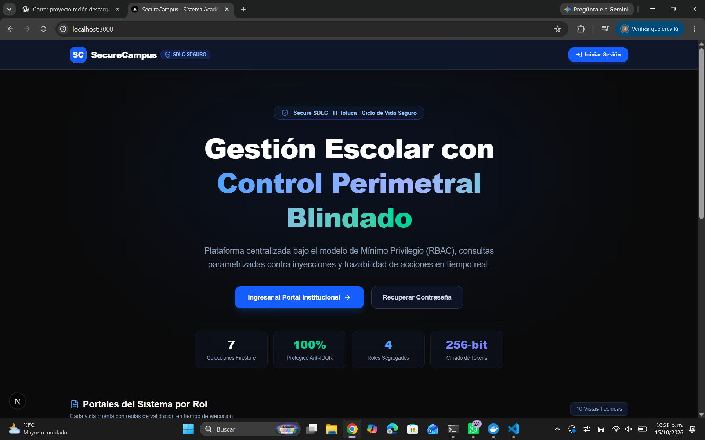
<figcaption>
Evidencia D0 · Aplicación SecureCampus funcionando localmente
</figcaption>
</figure>

## 3.1 Baseline: observación pasiva (apartado 5.2)

Comando por ruta: docker run --rm -t ghcr.io/zaproxy/zaproxy:stable zap-baseline.py -t http://host.docker.internal:3000/RUTA -s. Se rastrearon también recursos comunes de Next.js; las alertas no pueden atribuirse íntegramente a la ruta inicial.

| **Ruta**                | **FAIL** | **WARN (categorías)** | **PASS** |
|-------------------------|----------|-----------------------|----------|
| /profesor/grupos        | 0        | 7                     | 60       |
| /jefatura/grupos        | 0        | 7                     | 60       |
| /estudiante/kardex      | 0        | 7                     | 60       |
| /estudiante/solicitudes | 0        | 7                     | 60       |

| **Alerta repetida** | **Código** | **Interpretación y recomendación** |
|----|----|----|
| Información sensible en URL | 10024 | Investigar parámetros de prueba de login y recuperación; no transmitir contraseñas en parámetros URL. |
| Comentarios sospechosos | 10027 | Verificar si son comentarios de bundles generados por Next.js antes de concluir exposición real. |
| Contenido almacenable sin caché | 10049 | Revisar Cache-Control según sensibilidad y naturaleza de cada recurso. |
| CSP con comodines | 10055 | Definir una CSP más restrictiva compatible con la aplicación; validar en compilación de producción. |
| Divulgación de timestamp Unix | 10096 | Revisar si las marcas de tiempo observadas revelan datos sensibles. |
| Funciones JS peligrosas | 10110 | Identificar usos concretos y confirmar explotabilidad; podrían pertenecer a dependencias. |
| Cabecera cross-origin ausente o inválida | 90004 | Revisar nombre y configuración exacta en reporte ZAP y compatibilidad con recursos embebidos. |

<figure>
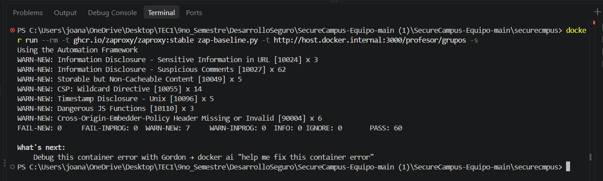
<figcaption>
Evidencia DAST P1 · Baseline Profesor / Grupos: 0 FAIL, 7 WARN, 60 PASS
</figcaption>
</figure>

<figure>
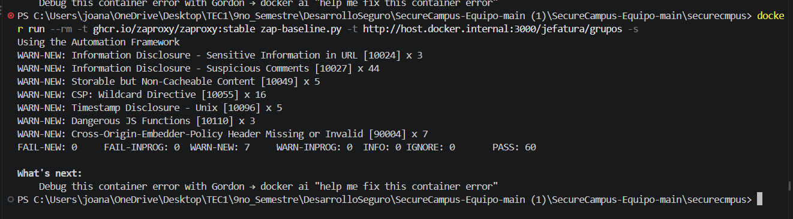
<figcaption>
Evidencia DAST P2 · Baseline Jefatura / Grupos: 0 FAIL, 7 WARN, 60 PASS
</figcaption>
</figure>

<figure>
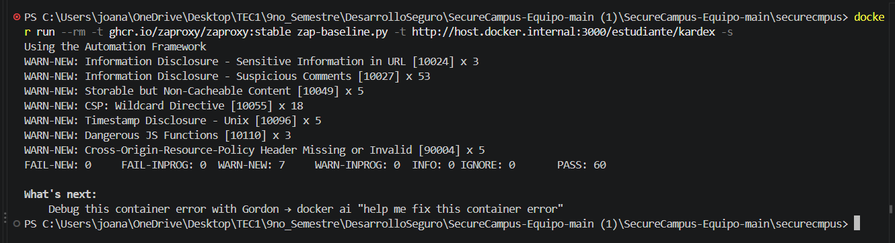
<figcaption>
Evidencia DAST P3 · Baseline Estudiante / Kárdex: 0 FAIL, 7 WARN, 60 PASS
</figcaption>
</figure>

<figure>
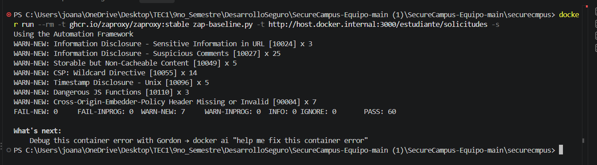
<figcaption>
Evidencia DAST P4 · Baseline Estudiante / Solicitudes: 0 FAIL, 7 WARN, 60 PASS
</figcaption>
</figure>

## 3.2 Validación manual de RBAC y filtrado de grupos

| **Cuenta / rol** | **Ruta** | **Comportamiento observado** | **Conclusión** |
|----|----|----|----|
| ESTUDIANTE | /profesor/grupos | Acceso denegado | Control de interfaz satisfactorio en caso probado. |
| ESTUDIANTE | /jefatura/grupos | Acceso denegado | Control de interfaz satisfactorio en caso probado. |
| PROFESOR (JUAN) | /profesor/grupos | Permite ver un grupo: REDES CONCURRENTES, TID-1002, periodo 2026-2. | Acceso legítimo; no demuestra aislamiento entre profesores. |
| PROFESOR (JUAN) | /jefatura/grupos | Acceso denegado | Control de interfaz satisfactorio en caso probado. |
| ESTUDIANTE | /estudiante/kardex | Muestra historial propio y avance académico | Visualización propia satisfactoria; no demuestra aislamiento de datos. |
| ESTUDIANTE | /estudiante/solicitudes | Formulario disponible, historial sin trámites | Visualización satisfactoria; no se creó solicitud. |
| PROFESOR (JUAN) | /estudiante/kardex | Permite abrir interfaz de Kárdex, vacía | Hallazgo: falta de restricción de rol a nivel de interfaz. |
| PROFESOR (JUAN) | /estudiante/solicitudes | Permite abrir formulario de solicitudes | Hallazgo: falta de restricción de rol a nivel de interfaz; no se probó escritura. |

<figure>
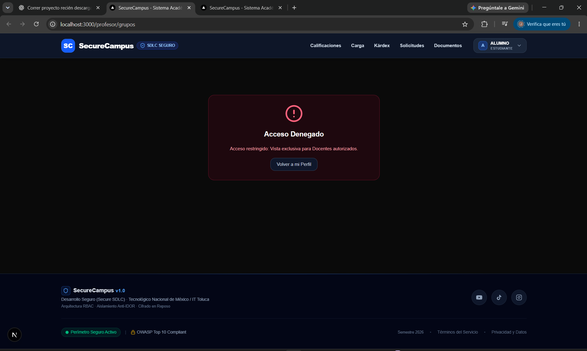
<figcaption>
Evidencia M1 · Estudiante: acceso denegado en Profesor / Grupos
</figcaption>
</figure>

<figure>
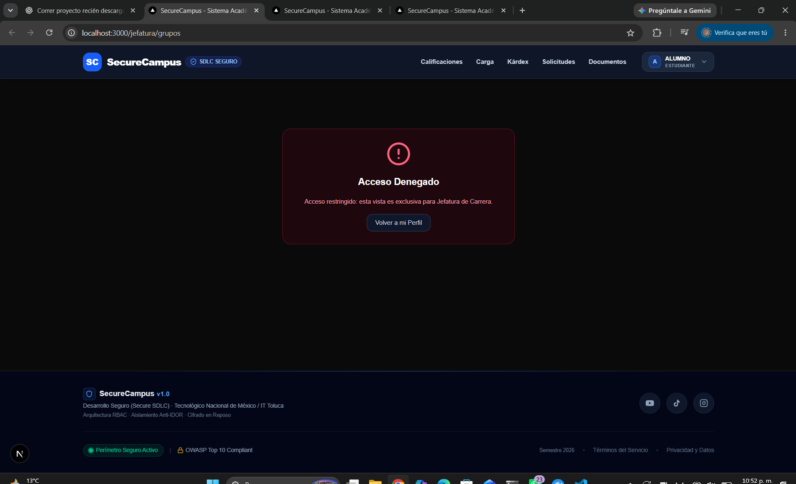
<figcaption>
Evidencia M2 · Estudiante: acceso denegado en Jefatura / Grupos
</figcaption>
</figure>

<figure>
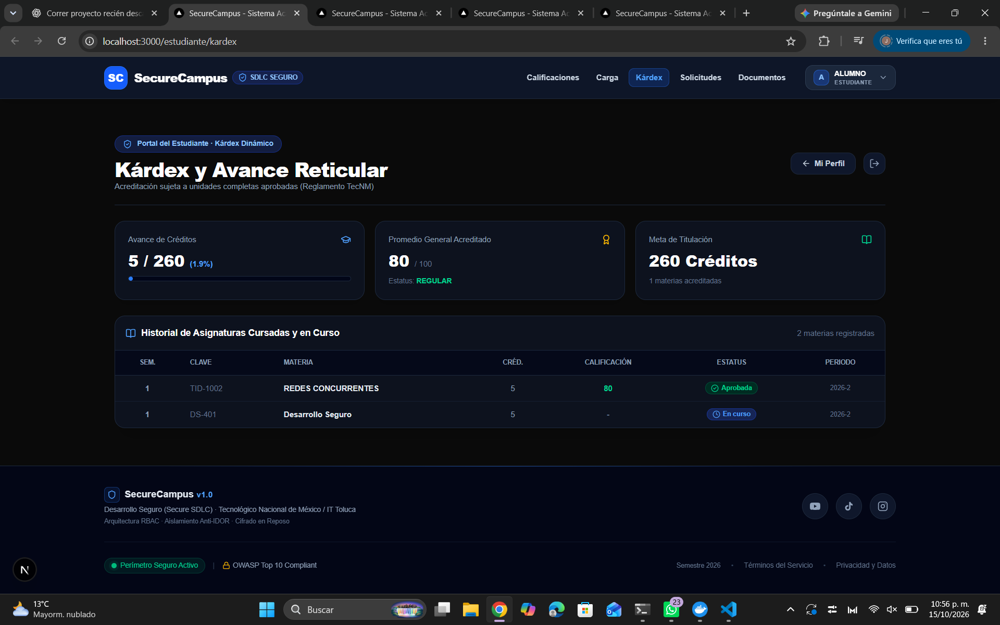
<figcaption>
Evidencia M3 · Estudiante: acceso propio a Kárdex
</figcaption>
</figure>

<figure>
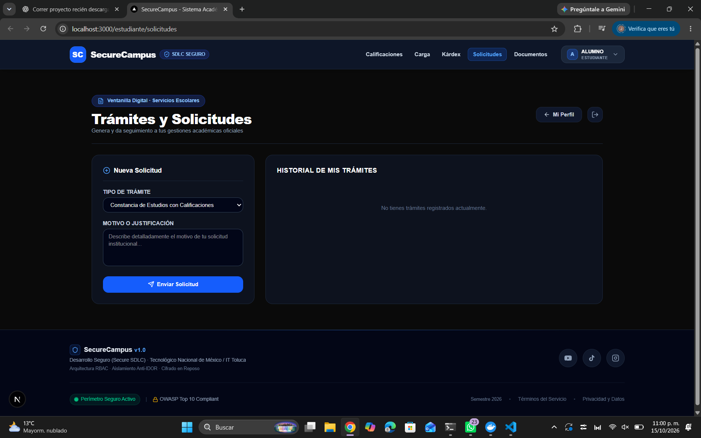
<figcaption>
Evidencia M4 · Estudiante: acceso a Solicitudes
</figcaption>
</figure>

<figure>
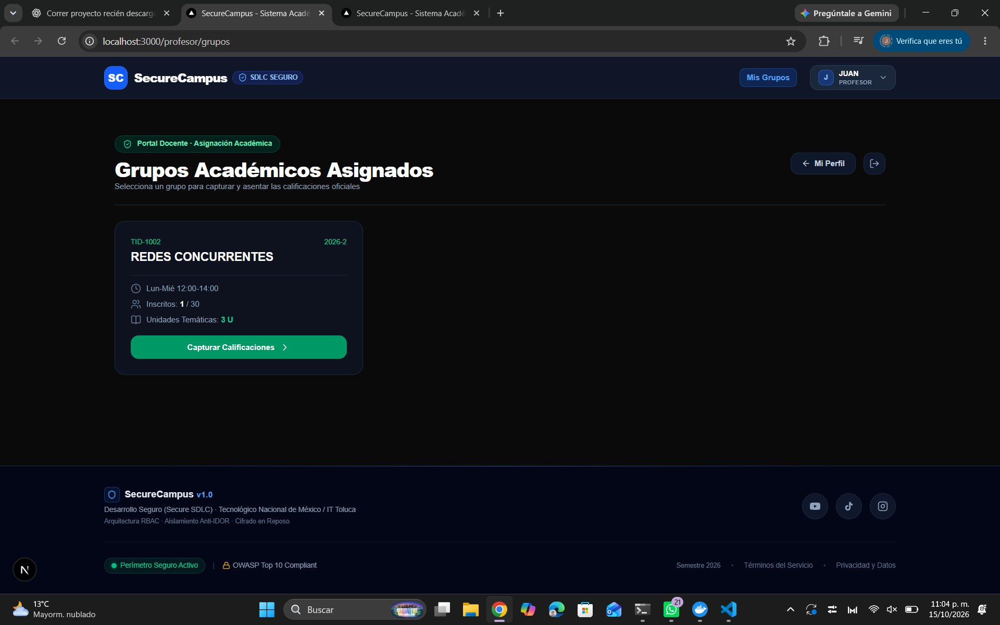
<figcaption>
Evidencia M5 · Profesor: visualización de grupo asignado
</figcaption>
</figure>

<figure>
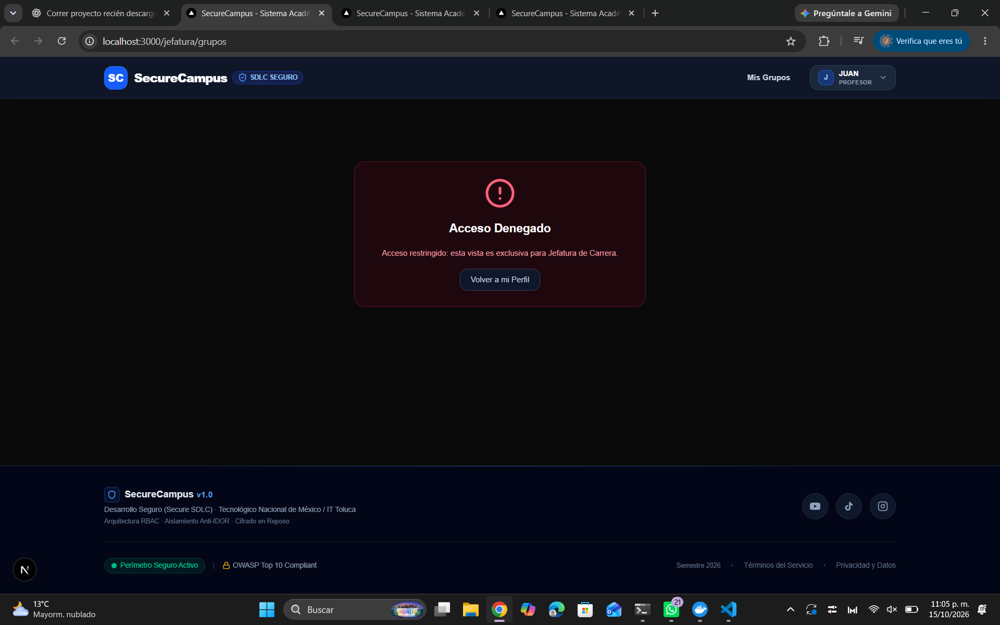
<figcaption>
Evidencia M6 · Profesor: acceso denegado en Jefatura
</figcaption>
</figure>

<figure>
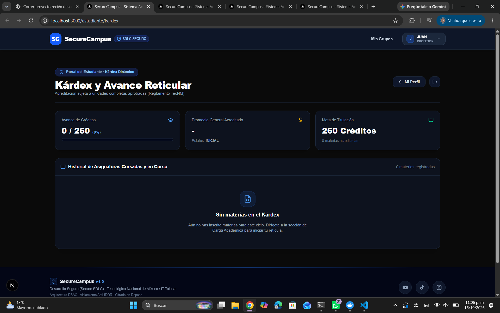
<figcaption>
Evidencia M7 · Profesor: acceso a Kárdex de estudiantes (sin datos)
</figcaption>
</figure>

<figure>
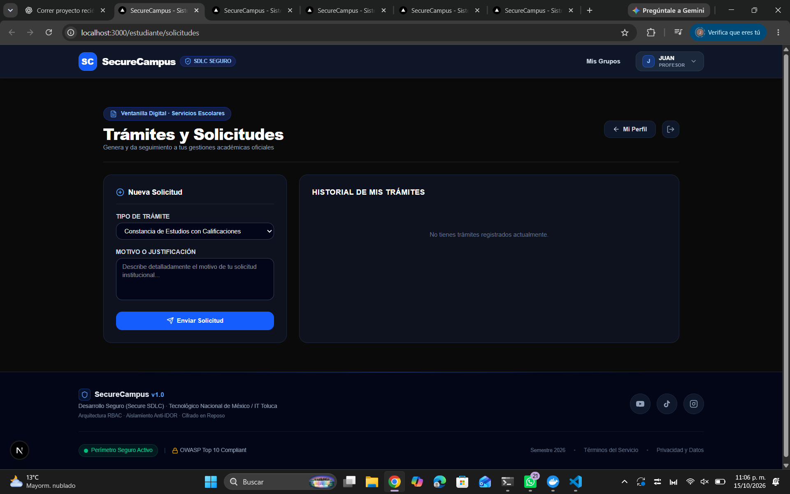
<figcaption>
Evidencia M8 · Profesor: acceso al formulario de Solicitudes
</figcaption>
</figure>

## 3.3 Hallazgos, propuestas y verificación pendiente

| **Identificador / estado** | **Fundamento** | **Solución propuesta** |
|----|----|----|
| RBAC-01 · Confirmado en interfaz; severidad preliminar media | Kárdex comprueba autenticación y perfil, pero no exige rol ESTUDIANTE. Un PROFESOR abrió la pantalla con historial vacío. | Exigir rol ESTUDIANTE antes de consultar y renderizar; validar lectura de calificaciones e inscripciones por UID en Firestore. Retest con cuenta PROFESOR. |
| RBAC-02 · Confirmado en interfaz; severidad preliminar media | Solicitudes valida sesión, pero no el rol. Un PROFESOR vio el formulario; no se confirmó escritura. | Exigir rol ESTUDIANTE; reglas Firestore para crear solo como alumnoUid autenticado e impedir cambios de estatus; retest con cuenta PROFESOR. |
| GRUPOS-01 · Riesgo potencial, no confirmado | Profesor filtra grupos por profesorUid, pero consulta inscripciones globalmente para conteo. | Reducir alcance de lecturas y validar permisos en Firestore; probar aislamiento con grupo de otro docente. |
| JEFATURA-01 · Riesgo potencial, no confirmado | La interfaz comprueba JEFE_CARRERA/ADMIN y envía escrituras directas a Firestore. | Restringir crear/actualizar grupos mediante reglas de Firestore; verificar con cuenta no privilegiada. |

## 3.4 Active Scan, XSS, corrección y retesting (apartados 5.3–5.7)

No se realizó zap-full-scan.py ni una prueba XSS activa. El laboratorio original describe una miniaplicación Flask vulnerable de ejemplo; esa prueba no se trasladó a SecureCampus. Tampoco se modificó código ni se reinició la aplicación para retesting, porque no se implementaron cambios. No se registran PASS/FAIL de XSS como resultados verificados.

## 4. Comparación SAST vs DAST (apartado 6)

| **Criterio** | **SAST observado** | **DAST observado** |
|----|----|----|
| Objeto | 4 archivos page.tsx | Aplicación local y recursos HTTP; además pruebas manuales con roles. |
| Resultados | 210 reglas por archivo, 0 findings en cada escaneo. | 7 categorías WARN y 0 FAIL por baseline; 2 fallas de restricción de interfaz encontradas manualmente. |
| Fortaleza | Identificó ausencia de alertas automáticas bajo las reglas probadas. | Mostró comportamiento real de la interfaz con rol PROFESOR en rutas de estudiantes. |
| Límite | No garantiza corrección de la lógica de roles. | Baseline sin autenticación no audita reglas Firestore; no hubo active scan ni pruebas de escrituras. |

## 5. Entrega, trazabilidad y reflexión (apartados 7–8)

Evidencias reunidas: cuatro capturas SAST; cuatro resúmenes baseline ZAP; ocho capturas de comprobaciones manuales; evidencia de preparación. No se realizó commit, push, modificación de código ni corrección. Este documento recoge los hallazgos observados hasta el cierre de pruebas.

**1. ¿Por qué 0 findings en SAST no equivale a aplicación segura?** Porque Semgrep detecta patrones cubiertos por sus reglas; en Kárdex y Solicitudes se observó una omisión de validación de rol en la interfaz que no fue reportada.

**2. ¿Por qué un WARN de ZAP debe validarse antes de declararlo vulnerabilidad?** Porque puede corresponder a recursos de desarrollo, dependencias, configuración contextual o falsos positivos; se requiere confirmar impacto y explotabilidad.

**3. ¿Qué diferencia observaste entre baseline y active scan?** Se ejecutó únicamente baseline pasivo, que inspeccionó respuestas y configuración. No se ejecutó active scan, que envía pruebas diseñadas para detectar debilidades al interactuar activamente.

**4. ¿Por qué 200 OK no descarta una vulnerabilidad?** Porque indica que el servidor respondió, no que el usuario estuviera autorizado; por ejemplo, un profesor obtuvo la pantalla Kárdex con HTTP funcional.

**5. ¿Qué aprendiste del hecho de tener que reiniciar Flask antes del retest?** El manual señala que, tras cambiar código, se debe reiniciar la instancia para validar la versión corregida. En esta adaptación no se cambió el código ni se hizo retesting.

**6. ¿Qué problema de autorización podría seguir existiendo aunque SAST y DAST no lo reporten?** Lectura o escritura de documentos Firestore sin restricciones suficientes, acceso a datos ajenos o a grupos de otro profesor; las reglas y estos escenarios no pudieron verificarse completamente.

## 6. Cierre y limitaciones

Conclusión: Los cuatro escaneos SAST informaron 0 findings. Los cuatro escaneos ZAP baseline informaron 7 tipos de WARN y 0 FAIL por ruta. Las pruebas de interfaz mostraron controles adecuados para estudiante→Profesor/Jefatura y profesor→Jefatura, pero permitieron al profesor abrir Kárdex y Solicitudes. No se observó exposición de calificaciones ajenas ni se comprobó la capacidad de crear solicitudes desde profesor. Sin acceso a las reglas de Firestore, no puede confirmarse la seguridad integral de la autorización ni el filtrado de grupos entre docentes. No se realizaron correcciones ni retesting.
